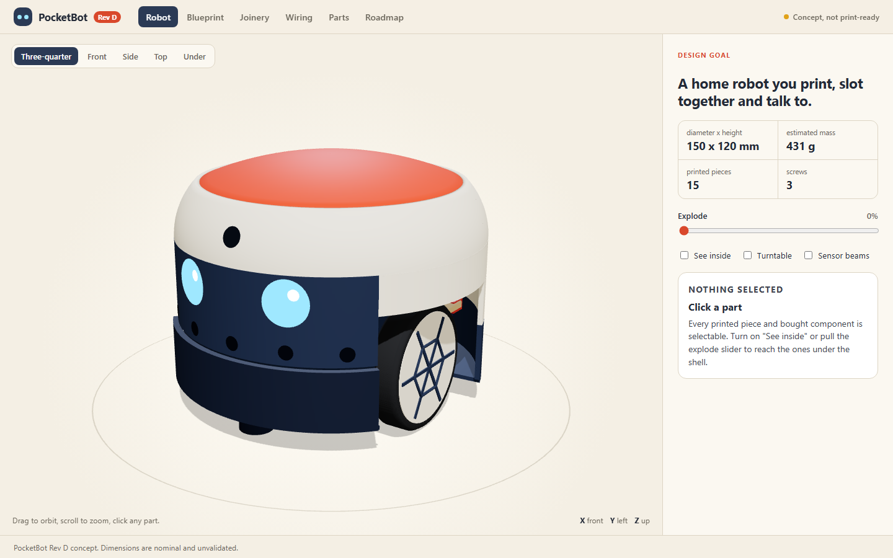
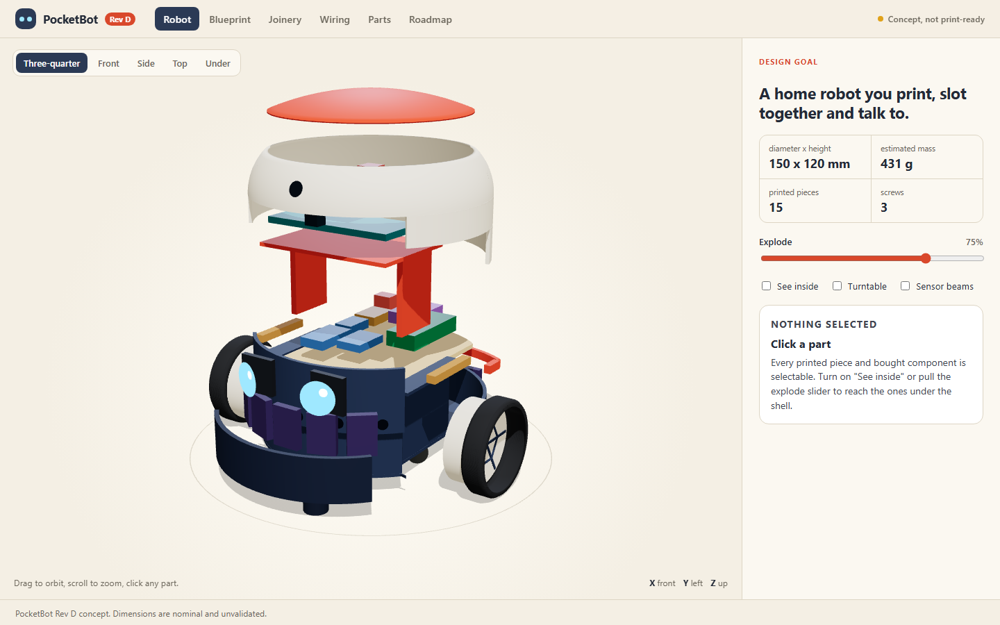
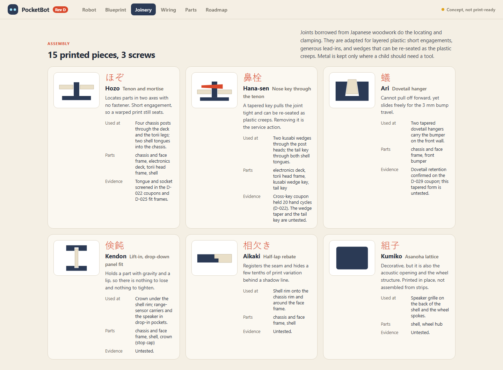
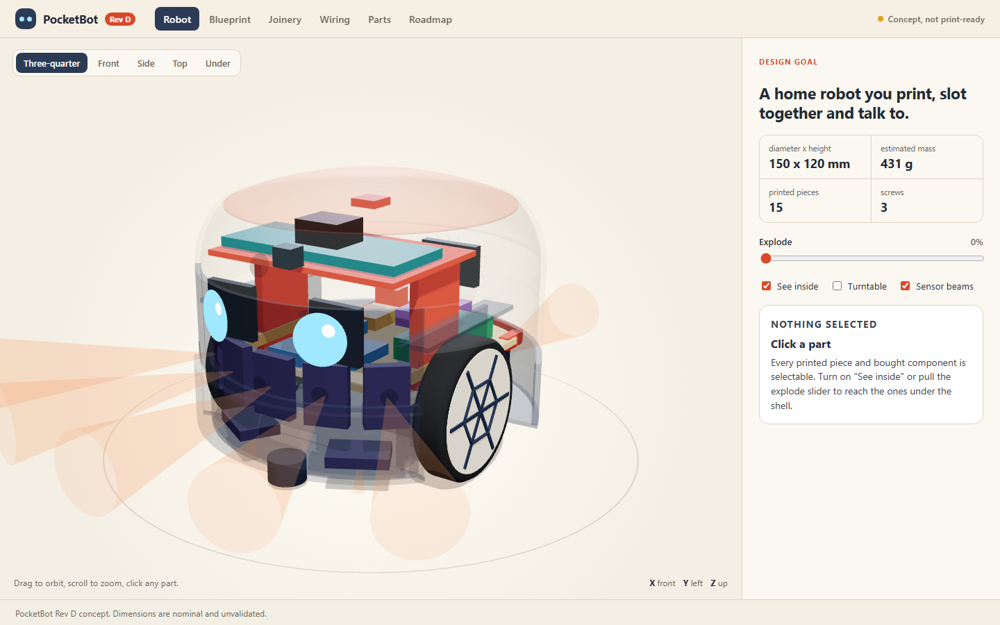
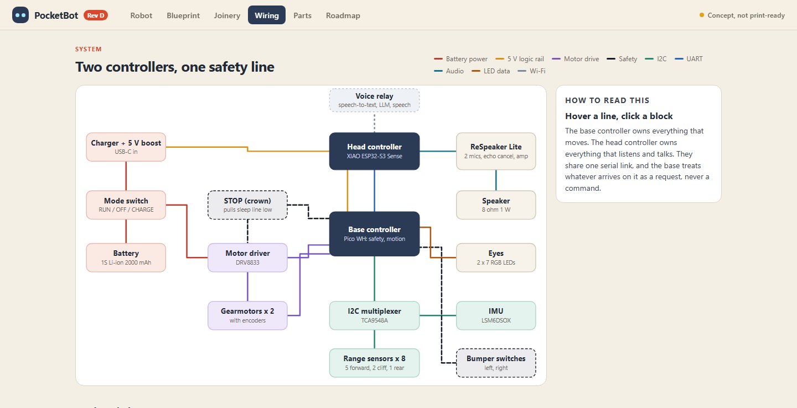
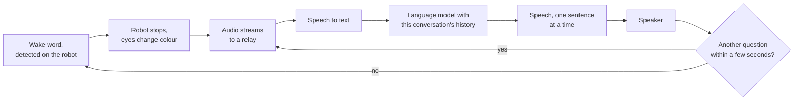
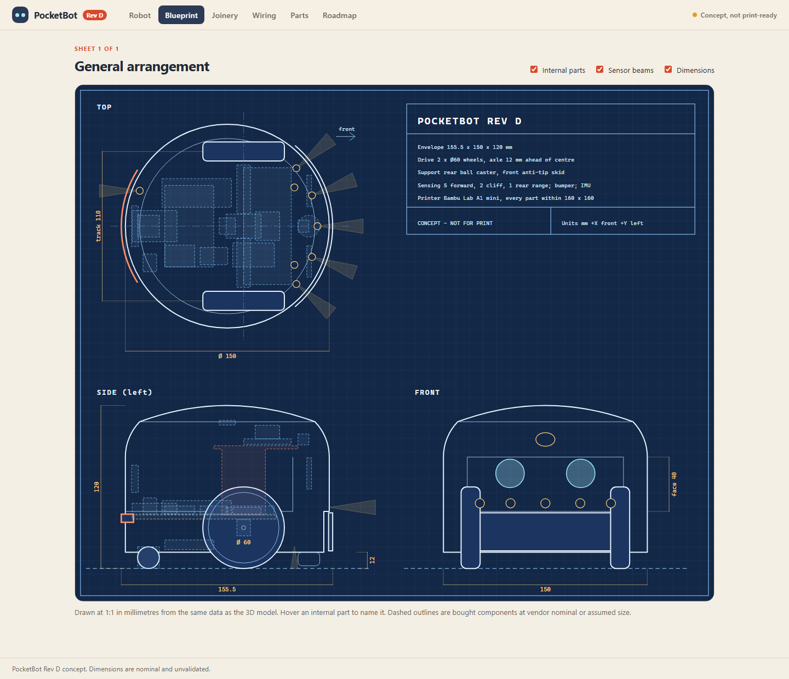

# PocketBot: a home robot you print, slot together and talk to

PocketBot is a design for a small home robot that drives itself around the floor, answers when you call it by name, and keeps talking for as long as you keep asking. It is meant to be printed on a small desktop printer and assembled almost without hardware: the parts lock together with joints borrowed from Japanese woodwork, and the whole robot uses three screws.

**[Open the interactive blueprint](https://pocketbot-rho.vercel.app)** to turn the model, pull it apart, look inside, and read the drawings, wiring and parts list.

This repository is a showcase. The working repository is private. What is here is the design, how it goes together, and a plain account of what has and has not been tested. The short version: this is a drawing backed by some printed joint trials. No robot has moved yet.

## The design

| | |
|---|---|
| Size | 150 mm across, 120 mm tall, 12 mm ground clearance |
| Printed pieces | 15 (12 different parts) |
| Screws | 3 |
| Mass | 431 g, estimated |
| Drive | Two 60 mm wheels inside the body circle, one rear ball caster |
| Sensing | Five range sensors forward, two looking down for edges, one rear; a bumper; a motion sensor |
| Voice | Two microphones with echo cancellation, one small speaker |
| Printer | Bambu Lab A1 mini; every part fits within 160 x 160 mm |

A few choices shape the rest:

- **Round, with the wheels inside the circle.** It can turn on the spot without a corner catching a chair leg.
- **The face is part of the chassis.** The eyes and forward sensors mount in a frame printed with the base, so the shell is only a hood and its fit cannot throw the sensors off.
- **The cap is the stop button.** Pressing the top anywhere cuts the motors through a switch, with no software involved.
- **One screw guards the battery.** Children will handle this robot, so reaching the battery and wiring takes a tool.

## How it goes together

Four posts rise from the chassis. The electronics deck drops over them and its underside traps both motors in their saddles. The head frame sleeves over the same posts, and one tapered wedge through each side clamps head, deck and motors together. The shell hooks under the face at the front and is locked at the back by a single key.

| Joint | Where it is used | Evidence so far |
|---|---|---|
| Hozo, tenon and mortise | Chassis posts through the deck and head frame; shell tongues into the chassis | Printed and cycled by hand |
| Hana-sen, key through the tenon | Two wedges through the posts; the tail key through the shell tongues | A straight key was cycled 20 times; the tapered wedge and tail key are untested |
| Ari, dovetail | Two hangers that carry the bumper | A dovetail rail held when lifted; this tapered form is untested |
| Kendon, lift-in panel | The cap under the shell rim; sensors and speaker in pockets | Untested |
| Aikaki, half-lap | The seam between shell and chassis | Untested |
| Kumiko, lattice | Speaker grille and wheel spokes | Untested |

These are adapted for layered plastic, not copied from wood: short engagements, generous lead-ins, and wedges that can be tapped tighter as the plastic creeps. Metal stays in two places. A printed bore loosens on a motor shaft over time, so each wheel has a set screw. The third screw pins the tail key.

## What is inside

Two small controllers split the work. The one in the base owns everything that moves: motors, wheel encoders, range sensors, bumper and the stop line. The one in the head owns everything that listens and talks: Wi-Fi, the microphones, the speaker and the camera. They share a single serial link, and the base treats whatever arrives on it as a request it may refuse.

That split is the safety design. A language model can ask the robot to go somewhere. It cannot drive a motor, clear a stop, or keep the robot moving: every motion request expires on its own, and silence from the head stops the wheels.

## How it talks

Nothing leaves the robot until it hears its name. After each answer the microphones stay open for a few seconds, so a follow-up question needs no wake word and the conversation can keep going deeper. The relay is one small service on a home computer or a rented server; the robot itself runs no language model. Nothing is stored unless someone asks the robot to remember it.

## The drawings

The 3D model, the dimensioned sheet, the wiring diagram and the parts list are all generated from one data file, so they cannot disagree with each other. Twelve automated checks run on that file: every part fits the printer, the bought components sit inside the shell without overlapping, the sensors clear each other and the bumper, the pin plan is valid for the board, and the estimated centre of mass sits behind the axle.

The page is static: Three.js for the model, SVG for the drawings, Vite to build it, Vercel to host it.

## What exists today

Done:

- The interactive blueprint and its twelve layout checks.
- A model of the safety and behaviour logic that runs on a computer, with 45 tests covering expiring commands, the stop latch, lost links and malformed input. It is a model, not firmware.
- Printed joint trials from the previous revision. I printed tongue-and-socket coupons and cycled the snug pair 20 times by hand, then printed two 138 x 104 mm frames with four joints each, which sat flat, fitted, and went through five assembly cycles. A dovetail rail held when lifted but had 1.7 mm of slack, which is why this revision's dovetails are tapered. A keyed wheel hub was printed and assembled as a mock-up.

Not done:

- No part of this revision has been printed. The wedge, the tail key and the bumper hanger have no test behind them.
- Nothing is wired as drawn. The circuit that keeps the motors off after a reset is not designed yet.
- The voice path is not built.
- Mass, balance, speed and thrust are estimates. Estimated thrust is about 0.9 of the robot's weight, which is probably too little for a 10 mm door threshold.
- The 5 V supply has 3% headroom on paper.

The joint trials were hand-fit checks. They say a joint goes together and comes apart; they say nothing about how much load it takes or how long it lasts.

## Main bought parts

| Part | Role |
|---|---|
| Raspberry Pi Pico WH | Base controller |
| Seeed XIAO ESP32-S3 Sense on a ReSpeaker Lite | Head controller, microphones, speaker amplifier, camera |
| 2 x Pololu 100:1 micro metal gearmotor with encoder | Drive |
| Pololu DRV8833 carrier | Motor driver |
| 8 x Adafruit VL53L4CD and a TCA9548A multiplexer | Range and edge sensing |
| Adafruit LSM6DSOX | Heading, tilt and pick-up detection |
| 2 x Adafruit NeoPixel Jewel | Eyes and listening light |
| Adafruit bq25185 charger with 5 V boost, 2000 mAh Li-ion pack | Power |

The full list with sources is on the Parts tab of the [blueprint](https://pocketbot-rho.vercel.app/#parts).

## What comes next

1. Print coupons for the wedge, tail key and bumper hanger.
2. Design the circuit that holds the motors off until someone deliberately arms the robot.
3. Bench-test the motors on the real battery, and the voice path on the head electronics alone.
4. Model the parts for printing, then print and assemble a first robot.
